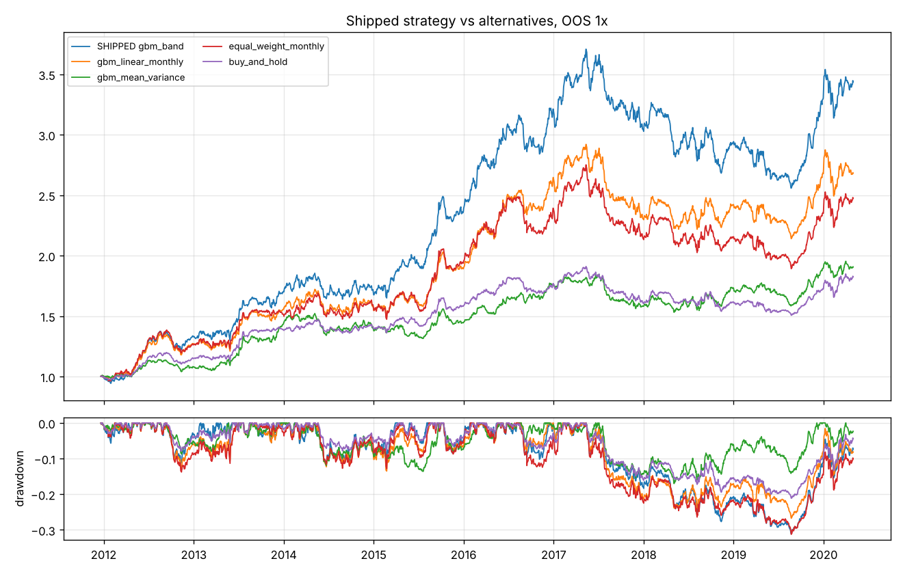
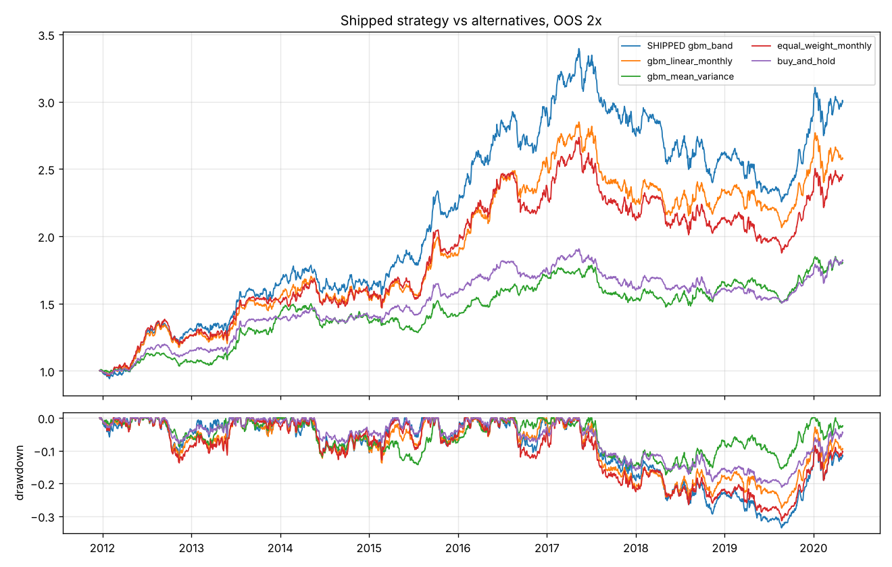

# Shipped strategy: walk-forward backtest

> DRY RUN: synthetic data. Rebuild on a vendor snapshot for real numbers.

Data `41567179a4` (synthetic_pit, point-in-time True) | 9 folds | strategy {'every': 5, 'band': 0.02, 'top_frac': 0.5}

## Out of sample, 1x costs

```
                      sharpe   cagr  ann_vol  max_dd  turnover_ann  cost_drag_ann  avg_gross
SHIPPED gbm_band       1.318  0.153    0.113   0.310        20.648          0.016      0.806
gbm_linear_monthly     1.135  0.121    0.105   0.267         6.253          0.005      0.735
gbm_mean_variance      1.021  0.077    0.076   0.170         5.791          0.006      0.436
equal_weight_monthly   1.005  0.110    0.110   0.312         2.168          0.001      0.836
buy_and_hold           1.046  0.072    0.069   0.211         0.570          0.000      0.504
```

## Cost stress (Sharpe)

```
                         1x     2x     3x
SHIPPED gbm_band      1.318  1.180  1.041
gbm_linear_monthly    1.135  1.092  1.048
gbm_mean_variance     1.021  0.935  0.848
equal_weight_monthly  1.005  0.995  0.985
buy_and_hold          1.046  1.041  1.036
```

## Regimes (Hurst/entropy, 2x costs, Sharpe)

```
                      calm_2x  turbulent_2x
SHIPPED gbm_band        1.139         1.233
gbm_linear_monthly      0.996         1.211
gbm_mean_variance       0.844         1.047
equal_weight_monthly    0.721         1.333
buy_and_hold            0.676         1.430
```

## Deflated Sharpe (chosen among the 5 rules above)

- PSR(SR>0) 1.000 | DSR 1.000 | expected max SR under null 0.15



