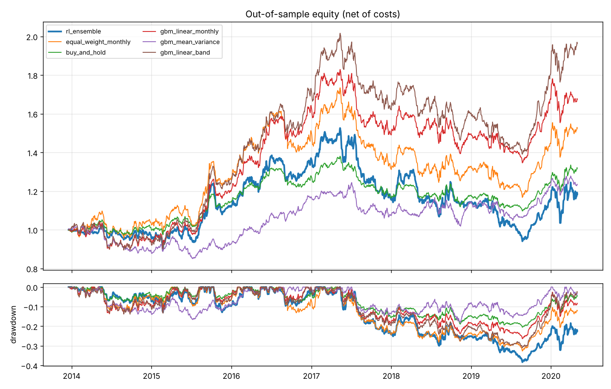
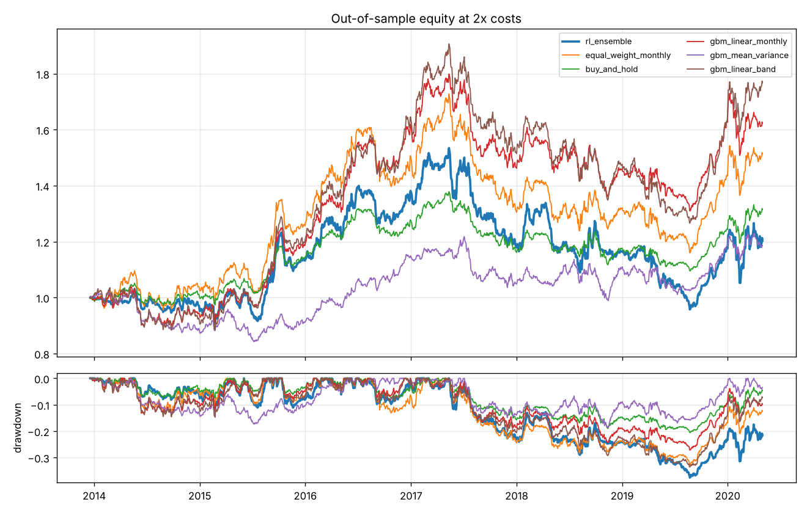
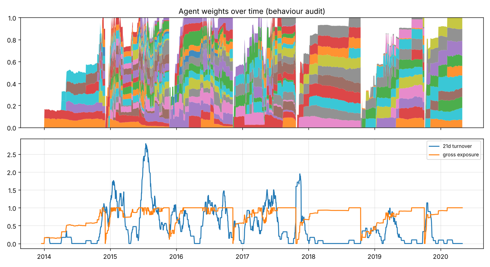

# Walk-forward report: t4_dryrun_band008

Grid `20261022-201634_t4_dryrun_band008_513943cfe2` | data hash `41567179a4` | source `synthetic_pit` | point-in-time: **True** | folds 7 x seeds 3 | 150000 steps/seed | reward `dsr` (kappa 0) | band 0.08

## Verdict

**DRY RUN (synthetic_pit data, not a real-data verdict): would read as -> FAIL - median-seed Sharpe at 2x costs 0.54 <= GBM+no-trade-band 0.82 (ensemble 0.29, worst seed 0.26). Ship the GBM+no-trade-band rule; archive the RL allocator as research.**

## Strategies, out of sample, 1x costs

```
                      sharpe   cagr  ann_vol  max_dd  turnover_ann  cost_drag_ann  avg_gross  beta_to_bench
rl_ensemble            0.269  0.026    0.122   0.384         5.324          0.004      0.771          0.890
equal_weight_monthly   0.630  0.066    0.111   0.327         2.240          0.001      0.829          0.870
buy_and_hold           0.643  0.043    0.069   0.205         0.570          0.000      0.502          0.550
gbm_linear_monthly     0.788  0.081    0.106   0.264         6.332          0.005      0.746          0.789
gbm_mean_variance      0.444  0.033    0.079   0.181         5.819          0.006      0.477          0.513
gbm_linear_band        0.962  0.108    0.113   0.310        20.854          0.016      0.814          0.820
```

## RL seeds (stitched OOS): median / worst / best

```
        sharpe_1x  sharpe_2x  sharpe_3x  turnover_ann
median      0.584      0.536      0.133        21.729
worst       0.319      0.265      0.043        18.678
best        0.705      0.539      0.302        22.750
```

```
      sharpe_1x  sharpe_2x  sharpe_3x  turnover_ann
seed                                               
0         0.584      0.536      0.302        18.678
1         0.319      0.265      0.043        22.750
2         0.705      0.539      0.133        21.729
```

## Cost stress (Sharpe, OOS)

```
                         1x     2x     3x
rl_ensemble           0.269  0.290  0.146
equal_weight_monthly  0.630  0.620  0.609
buy_and_hold          0.643  0.638  0.633
gbm_linear_monthly    0.788  0.744  0.700
gbm_mean_variance     0.444  0.367  0.290
gbm_linear_band       0.962  0.820  0.680
rl_median_seed        0.584  0.536  0.133
rl_worst_seed         0.319  0.265  0.043
```

## Regimes (Hurst/entropy classifier, 2x costs)

```
                                days  sharpe_2x  ann_ret_2x
strategy             regime                                
rl_ensemble          calm        997      0.332       0.036
                     turbulent   665      0.248       0.035
gbm_linear_band      calm        997      1.164       0.129
                     turbulent   665      0.331       0.039
gbm_linear_monthly   calm        997      1.039       0.103
                     turbulent   665      0.376       0.044
equal_weight_monthly calm        997      0.560       0.060
                     turbulent   665      0.703       0.083
```

## Deflated Sharpe (RL ensemble, 1x)

- trials (grid runs) on this data hash (MLflow): 9 (109 seed runs)
- expected max Sharpe under the null (annualised): 1.301
- PSR(SR>0) 0.755 | **DSR 0.004**

## Behaviour audit

- avg_gross: 0.771
- std_gross: 0.267
- beta_to_ew: 0.890
- corr_to_ew: 0.892
- avg_herfindahl: 0.150
- eff_n_assets: 8.902
- flags: []





